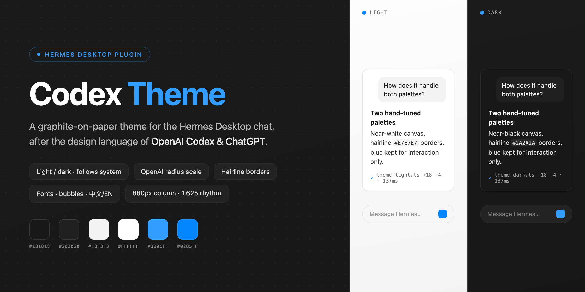
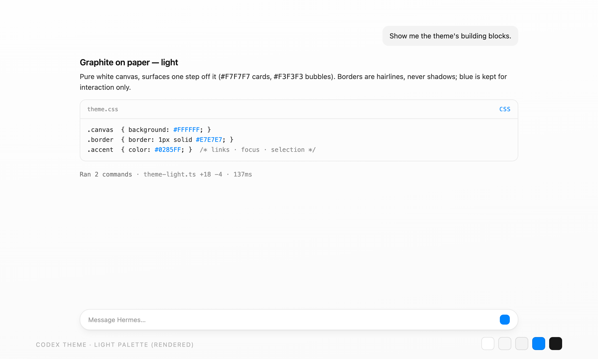
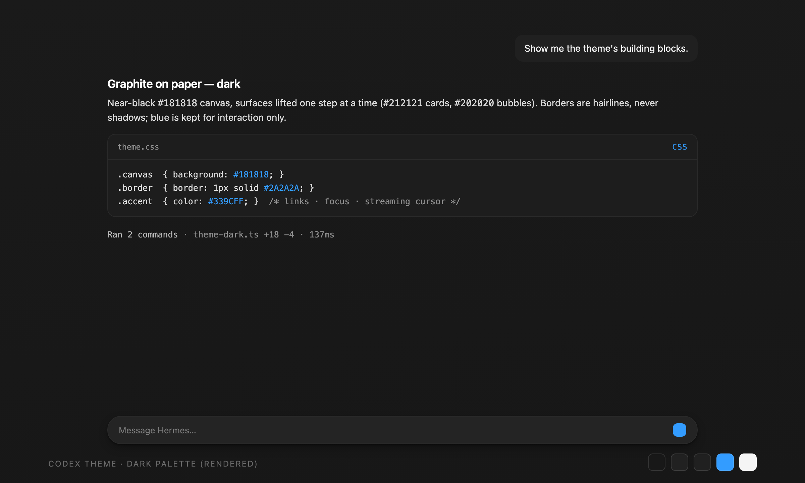

<p align="center">
  
</p>

<p align="center">
  English | <a href="README.zh-CN.md">简体中文</a>
</p>

<h1 align="center">Codex Theme</h1>

<p align="center">
  <em>A graphite-on-paper theme plugin for the Hermes Desktop — after the
  design language of OpenAI Codex &amp; ChatGPT<br>
  仿 OpenAI Codex 与 ChatGPT 设计语言的 Hermes 桌面主题插件</em>
</p>

<p align="center">
  <a href="LICENSE"></a>
  <a href="https://hermes-agent.nousresearch.com/docs"></a>
  <a href="https://hermes-agent.nousresearch.com/docs/developer-guide/desktop-plugin-sdk"></a>
</p>

<p align="center">
  <a href="#highlights">Highlights</a> •
  <a href="#screenshots">Screenshots</a> •
  <a href="#design-language">Design language</a> •
  <a href="#install">Install</a> •
  <a href="#settings">Settings</a>
</p>

Dual light/dark palettes that follow your system appearance, with typography,
radii and spacing tuned after the design language of the OpenAI Codex app and
ChatGPT. The settings page is bilingual (English / 中文), and so is everything
the plugin says to you.

## Highlights

- **Light / dark, hands-off** — two hand-tuned palettes; the app follows the
  system appearance, or you pin one in Settings
- **Graphite on paper** — flat surfaces, hairline borders (`#E7E7E7` / `#2A2A2A`),
  hierarchy carried by weight (600/500/400); blue (`#0285FF` light / `#339CFF`
  dark) is reserved for interaction, never chrome
- **OpenAI radius scale** — inline code 4px · sidebar rows 8px · controls 10px ·
  cards, bubbles, menus and dialogs 12px · composer 20px
- **Content spacing presets** — Compact 1.5 / Comfortable 1.625 (default) /
  Roomy 1.75 line height, with paragraph and bubble padding scaled to match
- **768 / 880 / 992px reading width** — Compact / Comfortable (default) /
  Roomy, wider than ChatGPT's 720–768px
- **Text & code font presets** — body text (Default / Serif / Mono) and code
  (Default / Fira Code / Courier), each with Chinese fallbacks so mixed
  Chinese/English text renders well; *Default* never overrides your font setup
- **Chat bubble colors** — pick background and text colors for your own bubbles
  and for assistant replies; *Default* keeps the theme's own look
- **English / 中文 interface** — follows the system & app language by default,
  or pin one in Settings; every label, hint and popup is localized
- **Feedback in one click** — Settings carries a *Open GitHub Issues* button
  that hands the URL to your browser via the OS
- **Respects your configuration** — text size, interface mode, translucency,
  session density and every other Hermes setting stay under Hermes' own
  control; the theme only paints theme-level tokens

## Screenshots

<p align="center">
  
  
</p>

<p align="center"><em>Rendered specimens of both palettes — light (left) and dark (right).</em></p>

## Design language

| Principle | Practice |
|---|---|
| Graphite on paper | Near-white canvas (`#FFFFFF`) / near-black canvas (`#181818`) |
| Weight-carried hierarchy | Headings 600, labels 500, body 400 — no decorative colour |
| Interaction-only blue | `#0285FF` light / `#339CFF` dark for links, focus rings, selection |
| Hairline borders | 1px strokes (`#E7E7E7` / `#2A2A2A`) instead of shadows; surfaces stay flat |
| Radius scale | 4px inline · 8px rows · 10px controls · 12px cards/bubbles/dialogs · 20px composer |
| Line height | Root 1.625 — measured from ZCode's chat body (14px × leading-relaxed); spacing presets 1.5 / 1.625 / 1.75 |
| Reading width | 880px default · presets 768 / 880 / 992px (ChatGPT: 720–768px) |

### Palettes

| Token | Dark | Light |
|---|---|---|
| Canvas | `#181818` | `#FFFFFF` |
| Sidebar | `#171717` | `#F9F9F9` |
| Card | `#212121` | `#F7F7F7` |
| User bubble | `#202020` | `#F3F3F3` |
| Border | `#2A2A2A` | `#E7E7E7` |
| Accent | `#339CFF` | `#0285FF` |

## Install

Listed in the official [plugin catalog](https://hermes-agent.nousresearch.com/docs/plugins):

```bash
hermes plugins install codex-theme
```

Or install straight from GitHub:

```bash
hermes plugins install hey-yx/hermes-codex-theme
```

Then open **Settings → Plugins → Codex Theme** and press *Reapply* (the theme
also applies itself once on first load).

> [!TIP]
> Manual / development install: copy `desktop/plugin.js` to
> `~/.hermes/desktop-plugins/codex-theme/plugin.js` and run
> **Reload desktop plugins** from ⌘K.

## Settings

Everything lives in **Settings → Plugins → Codex Theme**, grouped into
*Appearance*, *Typography & layout*, *Chat bubbles* and *General* panels:

| Setting | Options | Notes |
|---|---|---|
| Appearance mode | Follow system / Dark / Light | Follows the system appearance by default |
| Reading width | Compact (768px) / Comfortable (880px, default) / Roomy (992px) | Theme-level knob; Hermes has no built-in width setting |
| Content spacing | Compact (1.5) / Comfortable (1.625, default) / Roomy (1.75) | Line height + paragraph & bubble rhythm |
| Text font | Default / Serif / Mono | Chinese fallbacks in every preset; *Default* keeps theme/app fonts |
| Code font | Default / Fira Code / Courier | Fira Code / JetBrains Mono must be installed locally — otherwise the system mono kicks in |
| User bubble background | Color picker + *Default* | *Default*: theme gray (#F3F3F3 light / #202020 dark) |
| User bubble text | Color picker + *Default* | *Default*: theme foreground |
| Assistant bubble background | Color picker + *Default* | *Default*: transparent — replies sit straight on the canvas |
| Assistant bubble text | Color picker + *Default* | *Default*: theme foreground |
| Language | Follow system / 中文 / English | Plugin UI only; Hermes' own language is untouched |
| Feedback | *Open GitHub Issues* | Opens the repo's Issues page in your browser |

`⌘K` also carries two quiet rows: *Theme: Use Codex theme* and *Theme: Codex
theme settings* (searchable in both languages).

> [!NOTE]
> Choosing a non-default font preset overrides `--dt-font-sans` /
> `--dt-font-mono` wholesale — including a custom chat font set in Hermes'
> appearance settings. The *Default* preset overrides nothing.
> Bubble colors apply instantly, survive restarts and use the same color in
> light and dark; they paint while the Codex theme is active, and *Default*
> restores the theme's own colors.

### What this theme deliberately does not touch

Your Hermes configuration is yours. The theme paints **theme-level tokens
only** (palette, type stack, radii, spacing) and leaves every user-configurable
setting alone — text size (Settings → Appearance), interface mode,
translucency, session-list density, chat background, timestamps, and everything
in `config.yaml`. Two standing rules:

> [!IMPORTANT]
> - The theme never writes `--chat-text-scale` — that knob belongs to
>   **Settings → Appearance** and writing it would create two owners that
>   overwrite each other.
> - The theme takes over the palette **once** on first install. After that, a
>   theme you pick manually always wins; *Reapply* is opt-in.

## Disclosure

Per catalog rule 13, here is everything this plugin does that a user would want
to know before installing:

- **No network calls.** The plugin fetches nothing and phones home nothing.
- **No telemetry.** No usage reporting of any kind.
- **No credentials.** It reads and writes none.
- **No core patching.** Themes, palette commands and the settings page are
  registered through the Desktop plugin SDK only
  (`THEMES_AREA`, `PALETTE_AREA`, `ctx.registerSettingsPage`, `ctx.i18n`).
- **External link:** the *Feedback* button asks the OS to open the repo's
  GitHub Issues page in your browser (`ctx.os.openExternal`) — the only
  external action in the plugin, and only when you press the button.
- **Storage:** one plugin-scoped store (`ctx.storage`) holding your
  settings-page choices — appearance mode, reading width, content spacing,
  fonts, chat bubble colors and language — plus a first-install flag.
- **Styling:** the theme's `customCSS` is injected as a scoped style block by
  the app's own theme engine, exactly like user skins; it changes visuals, never
  behavior.

## Credits

Design language after the **OpenAI Codex app** and **ChatGPT** (graphite-on-paper
palette, radius scale, spacing rhythm). This is an independent community
theme — not affiliated with, endorsed by, or a product of OpenAI.

Built on the [Hermes Desktop Plugin SDK](https://hermes-agent.nousresearch.com/docs/developer-guide/desktop-plugin-sdk).
Licensed under the [MIT License](LICENSE).
